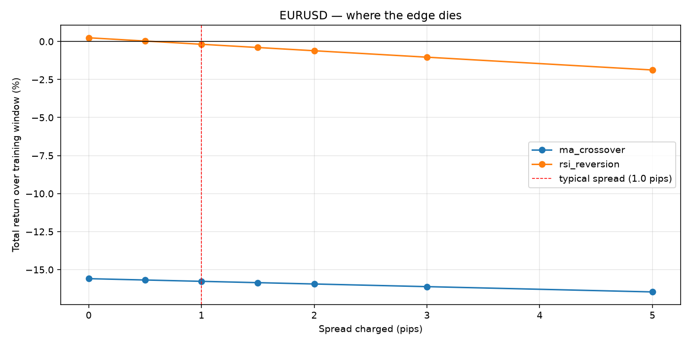
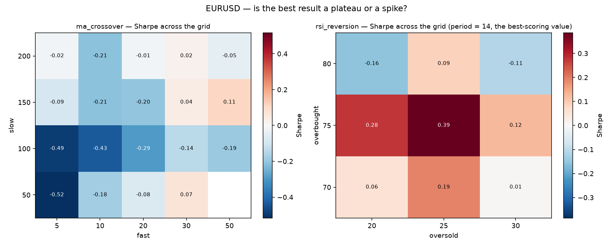
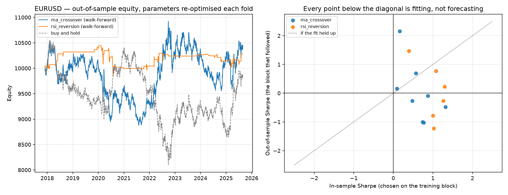
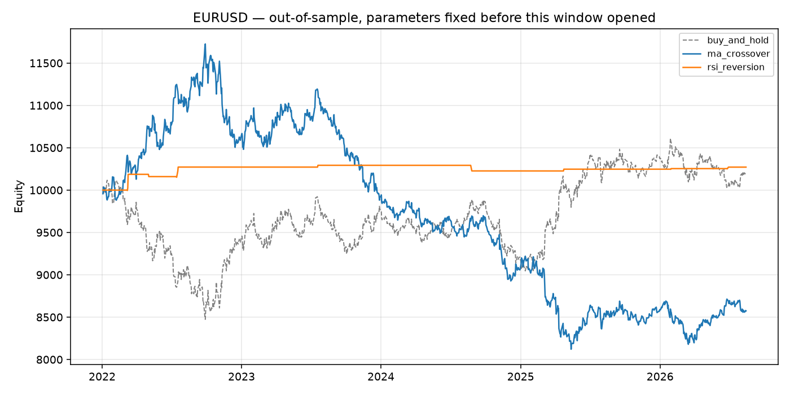

# Does the edge survive the spread?

A backtest built to find out whether two textbook strategies still make money
once you charge them what trading actually costs.

The short answer is no — and the point of this repository is the machinery that
makes that answer trustworthy rather than the answer itself.

Three shortcuts inflate a published backtest: zero costs, parameters chosen
after seeing the result, and reporting the best of many attempts as if it were
the only one. Each is removed here and measured. **In-sample Sharpe across four
instruments and two strategies averages 0.81; out of sample it averages 0.05.**

---

## The question

Most published backtests are run at zero cost, on the full history, with
parameters chosen after seeing the result. Each of those three shortcuts
inflates performance. This project removes them one at a time and measures
what is left.

The headline output is a single curve: **strategy return as a function of the
spread charged**. If a strategy is only profitable at a spread narrower than
anything a real venue quotes, it is not a strategy.



*EUR/USD, 2015–2021 training window. The RSI mean-reversion rule crosses into
negative territory at roughly 1 pip — which is about what a retail EUR/USD
spread actually is. The moving-average rule never had an edge to lose.*

---

## What the engine guarantees

These are enforced in code and covered by tests, not left to the strategy to
respect:

| Guarantee | Why it matters |
|---|---|
| Signal at close of `t`, fill at open of `t+1` | Same-bar execution is the single most common way a backtest invents profit |
| The overnight gap is held at the **previous** position | Collapsing to close-to-close hands the strategy a gap it never traded |
| Returns compound, never add | An always-long run reproduces buy-and-hold *exactly*, which is what makes the sanity test meaningful |
| Spread charged per unit of position change | Half on entry, half on exit, priced off the actual fill |
| Data validated before use, never forward-filled | An invented price produces invented trades |

Run `pytest` to check all of them:

```bash
python -m pytest tests/ -q
```

38 tests. Two are load-bearing:

`test_always_long_reproduces_buy_and_hold` — with a constant long position and
zero spread, the engine's equity curve must equal the instrument's own price
series to within floating-point error. If that fails, nothing else in this
repository means anything.

`test_training_block_always_precedes_its_test_block` — every walk-forward
training window must end before its test window begins. A leak here would not
look like a bug; it would look like a good result, which is why it is asserted
rather than assumed.

---

## Data

Daily OHLC from Yahoo Finance via `yfinance`, cached to CSV on first run so
every later run is offline and reproducible.

- **FX:** EUR/USD, GBP/USD, USD/JPY
- **Index:** S&P 500

**Known quality problems, found by the validator and not hidden:** the Yahoo
FX feed contains 71–187 bars per pair where the close sits outside the
high/low range, plus a handful of holiday bars with `High == Low`. Those bars
are reported on every run, and the flat ones are dropped. This is a real
limitation of free data and it bounds what the results below can claim.

---

## Layout

```
├── config.yaml            instruments, costs, windows, parameters
├── src/
│   ├── data.py            download, cache, validate, clean
│   ├── strategies.py      signal generators (target position -1/0/+1)
│   ├── engine.py          execution, costs, equity
│   ├── metrics.py         performance statistics
│   └── validation.py      grid search, walk-forward, deflated Sharpe
├── scripts/
│   ├── 01_download_data.py
│   ├── 02_baseline.py         both strategies vs buy-and-hold, training window
│   ├── 03_validation.py       sensitivity, walk-forward, multiple testing
│   └── 04_out_of_sample.py    the held-out window, spent once
├── tests/
│   ├── test_sanity.py     the tests the engine must pass to be believed
│   └── test_validation.py the tests that prove no parameter saw its own score
└── reports/figures/
```

## Running it

```bash
pip install -r requirements.txt
python scripts/01_download_data.py
python scripts/02_baseline.py     --instrument EURUSD   # costs
python scripts/03_validation.py   --instrument EURUSD   # sensitivity + walk-forward
python scripts/04_out_of_sample.py --instrument EURUSD  # the held-out window
```

Everything tunable — instruments, spreads, windows, strategy parameters —
lives in `config.yaml`. No numbers are hard-coded in the analysis.

---

## Results

### Training window only (EUR/USD, 2015–2021, 1 pip)

| Strategy | Total return | Sharpe | Max drawdown | Trades |
|---|---|---|---|---|
| Buy and hold | −5.3% | −0.06 | −14.8% | 1 |
| MA crossover (20/100) | −15.8% | −0.29 | −23.0% | 24 |
| RSI reversion (14, 30/70) | −0.2% | 0.01 | −7.5% | 98 |

Neither rule beats doing nothing. The RSI rule is roughly flat before costs
and slightly negative after them, which is the more interesting of the two
failures: it means the raw signal has *something* in it, and the spread is
what removes it.

> Parameters here are the conventional textbook defaults, chosen before
> looking at any result. The out-of-sample window (2022 onward) has not been
> touched.

### Parameter sensitivity — plateau or spike?



Sharpe across the whole parameter grid, training window. The moving-average
surface is almost entirely negative — 21% of its 19 combinations score above
zero, and the best one sits on the edge of the grid rather than in the middle
of a stable region. RSI is friendlier: 70% of its 27 combinations are positive,
which at least suggests the sign is a property of the rule and not of one lucky
pair of thresholds.

### Walk-forward — what survives when parameters cannot cheat

Parameters are re-optimised on a rolling 756-bar window and then traded,
unchanged, over the 252 bars that follow. No parameter ever sees the returns it
is scored on.



The scatter is the finding. Every fold's in-sample Sharpe is positive — that is
what optimisation is for. The out-of-sample Sharpes scatter around zero, and
12 of the 16 points sit below the diagonal.

Across all four instruments and both strategies, 8 folds each:

| Instrument | Strategy | In-sample Sharpe | Out-of-sample Sharpe | OOS return | Parameter stability |
|---|---|---|---|---|---|
| EUR/USD | MA crossover | +0.63 | +0.10 | +3.7% | 29% |
| EUR/USD | RSI reversion | +1.07 | +0.17 | +2.8% | 0% |
| GBP/USD | MA crossover | +0.73 | +0.04 | −0.6% | 14% |
| GBP/USD | RSI reversion | +0.77 | +0.39 | +4.9% | 0% |
| USD/JPY | MA crossover | +0.71 | +0.28 | +17.5% | 14% |
| USD/JPY | RSI reversion | +1.04 | −0.40 | −6.9% | 29% |
| S&P 500 | MA crossover | +0.73 | −0.37 | −52.3% | 14% |
| S&P 500 | RSI reversion | +0.84 | +0.23 | +9.7% | 29% |
| **Mean** | | **+0.81** | **+0.05** | | |

**In-sample Sharpe 0.81, out-of-sample 0.05.** 69% of all 64 folds scored worse
out of sample than in. *Parameter stability* is the share of folds that
re-selected the previous fold's winning parameters; it never exceeds 29% and is
zero twice. A rule whose optimal parameters change completely every year has not
found a property of the market — it has fitted the window.

### The multiple-testing bill

Reporting the best of 27 parameter sets is reporting the maximum of a sample.
The deflated Sharpe ratio (Bailey & López de Prado, 2014) asks how good the best
result would look if none of the candidates had any edge at all.

| Strategy | Trials | Best in-sample Sharpe | Sharpe luck alone would produce | Deflated Sharpe |
|---|---|---|---|---|
| MA crossover | 19 | +0.105 | +0.343 | 0.26 |
| RSI reversion | 27 | +0.386 | +0.348 | 0.54 |

Both best results are **below or barely above what searching that grid would
have produced on noise**. Neither clears the conventional 0.95 threshold. The
RSI result is the more instructive: its Sharpe of 0.386 looks like something
until you notice that 27 attempts at a random series would have produced 0.348.

### Out-of-sample — spent once

Parameters fixed on data ending 2021-12-31, then applied to 2022-01-03 onward
(1,200 bars). Nothing was re-tuned; this window was opened once.



| Strategy | Total return | CAGR | Sharpe | Max drawdown | Exposure |
|---|---|---|---|---|---|
| Buy and hold | +1.4% | +0.3% | +0.09 | −16.2% | 100% |
| MA crossover (50/150) | **−13.9%** | −3.2% | −0.38 | −30.7% | 100% |
| RSI reversion (14, 25/75) | +2.7% | +0.6% | **+0.62** | −0.7% | **1%** |

The moving-average rule did what the walk-forward predicted: it lost money and
drew down twice as hard as holding.

The RSI line is the one worth reading carefully, because at a glance it looks
like a win. A Sharpe of 0.62 against buy-and-hold's 0.09 is a large difference —
and it is almost meaningless. **The rule held a position in 1% of bars.** It
earned 0.58% a year while sitting in cash 99% of the time, with an annualised
volatility of 0.92%. Sharpe is scale-free and cash has no volatility, so a rule
that barely trades can post an excellent ratio on a rounding error. That is why
`04_out_of_sample.py` prints exposure directly beneath Sharpe: without it, this
row reads as a discovery instead of a savings account with extra steps.

---

## What this backtest does **not** prove

- **Daily bars hide the path.** A strategy that looks flat on daily closes may
  have been stopped out intraday. Nothing here models intraday risk.
- **Spread is modelled as constant.** Real spreads widen exactly when you most
  want to trade — news, rollover, thin liquidity. A fixed pip charge is
  optimistic even when the number looks conservative.
- **No slippage, no partial fills, no funding.** Overnight swap alone would
  change the economics of a strategy holding positions for weeks.
- **Free retail data has errors**, documented above.
- **Three currency pairs and one index is not a universe.** Results do not
  generalise beyond what was tested.
- **A negative result is not proof of absence.** It says these rules, with
  these parameters, on this data, over this window, did not survive realistic
  costs. Nothing more.
- **The walk-forward window sizes were not themselves validated.** 756 training
  bars and 252 test bars are reasonable defaults, not optimised ones — and
  optimising them would be one more parameter to deflate for.
- **The deflated Sharpe assumes the trials are exchangeable.** Adjacent
  parameter sets in a grid are correlated, not independent draws, so the
  penalty computed here is closer to a lower bound on the correction than an
  exact one.
- **One walk-forward objective.** Folds are selected on Sharpe. Choosing on
  Calmar or on total return would pick different parameters and could tell a
  different story; only one was tried, and it was fixed before the results
  were seen.

---

## Why this exists

Built as a portfolio piece for quantitative and trading-analysis roles. The
intent was not to find a profitable strategy — it was to build the
infrastructure that can tell the difference between a real edge and a
well-dressed artefact, and to be willing to publish the answer when it comes
back negative.

*Sergio Alegre — [linkedin.com/in/sealegref](https://www.linkedin.com/in/sealegref)*
